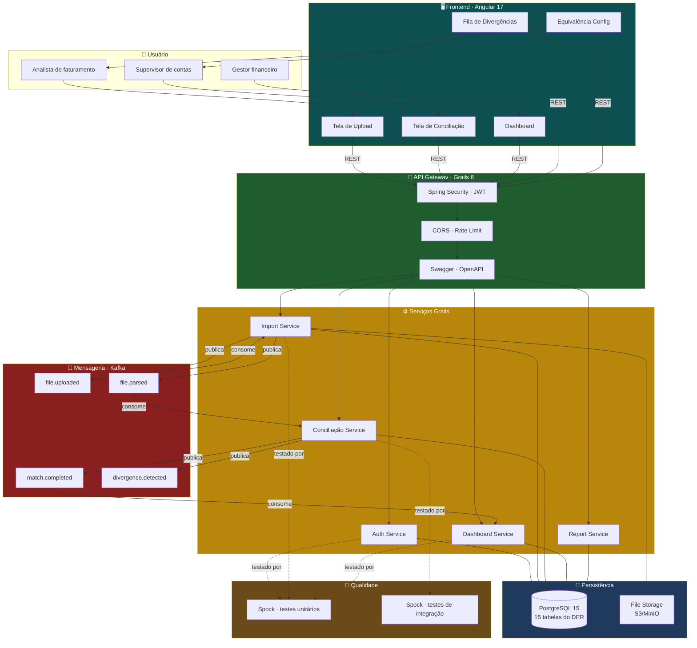

# ZG-MVP

Sistema de conciliação entre faturamento hospitalar (prestador) e demonstrativo de pagamento (operadora). Automatiza o cruzamento item a item, detecta glosas não justificadas e apresenta resultado em dashboard.

**Stack:** Grails 6 (backend) · Angular 17 (frontend) · PostgreSQL 15 · Kafka · Spock · Swagger

---

## Índice

1. [O problema](#1-o-problema)
2. [Escopo do MVP](#2-escopo-do-mvp)
3. [Arquitetura (diagrama de blocos)](#3-arquitetura)
4. [Fluxo de execução (fluxograma)](#4-fluxo-de-execução)
5. [Features × Estórias de usuário](#5-features--estórias)
6. [Decisões arquiteturais](#6-decisões-arquiteturais)
7. [Métricas de sucesso](#7-métricas-de-sucesso)

---

## 1. O problema

O analista de faturamento hospitalar recebe dois documentos que **não conversam**:

- **Fatura** (hospital): itens e remessas, cada linha com código, descrição, valor cobrado
- **Demonstrativo** (operadora): cada uma com valor apresentado, pago, glosa e motivo

O analista precisa cruzar **item a item** — sem chave única natural, com códigos divergentes, descrições diferentes, nomes escritos errados e podendo ter linhas consolidadas que cobre mais de um item de uma vez. Isso leva horas de trabalho manual, e o resultado ainda precisa ser transformado em relatório para recorrer das glosas.

**O ZG-MVP automatiza esse cruzamento**

---

## 2. Escopo do MVP

### Dentro do escopo

| Funcionalidade | Descrição |
|---|---|
| **Upload de arquivos** | CSV/XLSX de fatura e demonstrativo, com validação de formato |
| **Detecção de layout** | Identificação automática da operadora e mapeamento de colunas |
| **Equivalência de códigos** | TUSS ↔ código do convênio |
| **Equivalência de motivos** | ANS ↔ código próprio |
| **Conciliação automática** | Match em 3 níveis: remessa, guia, item |
| **Tratamento de casos especiais** | Linha consolidada (agregação), item sem match (inadimplência), item extra (excedente) |
| **Cálculo de glosa** | Glosa calculada, dif. glosa, dif. valor, tipo de glosa |
| **Detecção de divergências** | nome, descrição, matricula, etc |
| **Dashboard** | KPIs + top 5 itens glosados + top 5 motivos + gráficos |
| **Visualização em 4 níveis** | Item, guia, remessa, beneficiário |
| **Fila de divergências** | Workflow aberta → em análise → resolvida → ignorada |
| **Exportação CSV/XLSX** | Por nível + por divergência |

### Fora do escopo

| Funcionalidade | Descrição | Motivo |
|---|---|---|
| **Tratativa de críticas** | Ao identificar uma divergência de valor ou dado, o sistema deve gerar uma "Crítica".  O usuário deve ter a opção de "Aceitar" a crítica (assumir o erro do hospital) ou "Rejeitar/Forçar" | Fica no banco do sistema, não é requisito do MPV. |
| **Gerar e particionar remessas de faturamento** | O sistema deve distribuir as guias de faturamento em arquivos de remessa conforme o limite máximo estabelecido pela especificação TISS vigente | Risco jurídico de alterar dados originais. |
| **Cadastrar tabelas de referência** | Tabelas de referência com suas vigências, para que o sistema possa validar os valores e códigos utilizados na conciliação. | As tabelas de referência serão previamente padronizadas e disponibilizadas pelo sistema, dispensando a necessidade de cadastro manual pelo administrador. |


---

## 3. Arquitetura

### 3.1 Diagrama de blocos



### 3.2 Componentes e papéis

| Componente | Papel | Tecnologia | Por que existe |
|---|---|---|---|
| **Frontend** | SPA com 5 telas: upload, conciliação, dashboard, divergências, equivalência | Angular 17 + TypeScript | Interação do analista, consumo de REST |
| **API Gateway** | Ponto único de entrada; autentica, autoriza, roteia, documenta | Grails 6 + Spring Security + SpringDoc | Centraliza segurança; expõe Swagger; evita acoplamento direto |
| **Auth Service** | Login, JWT, gestão de usuários | Grails + Spring Security | Multi-tenant (cada hospital vê seus dados) |
| **Import Service** | Recebe arquivo, valida, detecta layout, persiste, publica evento | Grails + Apache POI (XLSX) + OpenCSV | Separar upload de processamento (usuário não espera) |
| **Conciliação Service** | Executa match em 3 níveis, calcula glosa, detecta divergências | Grails (Groovy) | Coração do MVP; roda em background via Kafka |
| **Dashboard Service** | Agrega totais por nível, monta top 5, cacheia | Grails + Caffeine cache | Queries pesadas cacheadas; dashboard responde em O(1) |
| **Report Service** | Gera CSV/XLSX sob demanda | Grails + Apache POI | Exportação para recurso de glosa |
| **Kafka** | Fila de eventos entre Import e Conciliação | Apache Kafka | Desacopla upload de processamento (59 mil itens demoram minutos) |
| **PostgreSQL** | Persistência de todas as entidades | PostgreSQL 15 | DER com 15 tabelas (ver `docs/04-modelagem/der.sql`) |
| **File Storage** | Armazena arquivos originais (comprovação jurídica) | S3 ou MinIO | Auditoria: o CSV original não pode ser perdido |
| **Spock** | Testes unitários e de integração | Spock + Groovy | Framework de teste exigido pelo stack |
| **Swagger** | Documentação interativa das APIs | SpringDoc OpenAPI | Contrato entre front e back; onboarding de novos devs |

### 3.3 Fluxo de comunicação

```
Usuário → Angular → API Gateway (Grails) → Service específico → PostgreSQL
                                       ↓
                                   Kafka (eventos assíncronos)
```

- **Síncrono:** upload do arquivo (usuário espera confirmação)
- **Assíncrono:** parsing e conciliação (usuário não espera; pode navegar)
- **Cache:** dashboard (resposta em <100ms)

---

## 4. Fluxo de execução

### 4.1 Fluxograma completo

```mermaid
flowchart TD
    
    START([Início]) --> UP[Analista faz upload]
    UP --> V1{Arquivo válido?}

    V1 -->|Não| E1[Erro: formato, encoding ou tamanho]
    E1 --> T1[Tentar novamente]
    T1 --> V1

    V1 -->|Sim| V2{Hash já existe?}
    V2 -->|Sim| E2[Erro: arquivo já importado]
    E2 --> C1[Consultar importação existente]
    C1 --> FIM1([Fim])

    V2 -->|Não| P1[Detectar operadora pelo layout]


    P1 --> P2{Layout conhecido?}
    P2 -->|Não| M1[Analista mapeia colunas manualmente]
    P2 -->|Sim| N1[Parsing do arquivo]
    M1 --> N1
    
    N1 --> N2[Persistir em importacao]
    N2 --> N3[Publicar evento file.uploaded]
    
    N3 --> PA1[Conciliação Service consome]
    PA1 --> PA2[Aplicar equivalência de código]
    PA2 --> PA3[Aplicar equivalência de motivo]
    PA3 --> PA4[Persistir em prestador_* ou operadora_*]
    PA4 --> PA5[Publicar evento file.parsed]
    
    PA5 --> MC1[Match nível remessa]
    MC1 --> MC2[Match nível guia]
    MC2 --> MC3[Match nível item]
    
    MC3 --> CE1{Casos especiais?}
    CE1 -->|Linha consolidada| CE2[Marcar AGREGACAO<br/>rateio proporcional]
    CE1 -->|Sem match no demo| CE3[Marcar NAO_ASSOCIADO]
    CE1 -->|Item extra no demo| CE4[Marcar EXCEDENTE]
    CE1 -->|Normal| CE5[Marcar 1:1]
    
    CE2 --> CL1[Calcular glosa calculada]
    CE3 --> CL1
    CE4 --> CL1
    CE5 --> CL1
    
    CL1 --> CL2[Calcular dif. glosa]
    CL2 --> CL3[Calcular dif. valor]
    CL3 --> CL4[Classificar tipo de glosa]
    CL4 --> CL5[Marcar glosa sem motivo]
    
    CL5 --> DV1[Detectar divergências]
    DV1 --> DV2[VD · valor divergente]
    DV2 --> DV3[GI · glosa inconsistente]
    DV3 --> DV4[DD · descrição divergente]
    DV4 --> DV5[MD · matrícula divergente]
    DV5 --> DV6[NB · nome em branco]
    DV6 --> DV7[MB · motivo em branco]
    DV7 --> DV8[GP · guia prestador divergente]
    DV8 --> DV9[CD · código com zeros]
    DV9 --> DV10[LC · linha consolidada]
    DV10 --> DV11[2R · guia em 2 remessas]
    DV11 --> DV12[DUP · possível duplicidade]
    
    DV12 --> AG1[Agregar totais por nível]
    AG1 --> AG2[Montar top 5 itens]
    AG2 --> AG3[Montar top 5 motivos]
    AG3 --> AG4[Publicar evento match.completed]
    
    AG4 --> AP1[Dashboard Service consome]
    AP1 --> AP2[Dashboard com KPIs]
    AP2 --> AP3[Abas item/guia/remessa/benef]
    AP3 --> AP4[Fila de divergências]
    AP4 --> END([Analista revisa])
    END --> FIM([Fim])

style FIM fill:#0E4F52,color:#fff
    
    style START fill:#0E4F52,color:#fff
    style END fill:#0E4F52,color:#fff
    style E1 fill:#8A1F1F,color:#fff
    style E2 fill:#8A1F1F,color:#fff
    style AP2 fill:#1F5C2E,color:#fff
```



### 4.2 Passo a passo detalhado

| # | Passo | Entrada | Saída | Tabela | Erros possíveis |
|---|---|---|---|---|---|
| 1 | **Upload** | CSV/XLSX/XML | Arquivo no storage | `importacao` (status=PENDENTE) | Formato inválido, arquivo > 50MB |
| 2 | **Validação** | Arquivo | Arquivo validado | — | Encoding errado, hash duplicado |
| 3 | **Detecção de layout** | Arquivo | Operadora identificada | — | Layout desconhecido (fallback: manual) |
| 4 | **Parsing** | Arquivo + mapeamento | Linhas estruturadas | `prestador_*` ou `operadora_*` | Linha malformada, coluna faltando |
| 5 | **Equivalência de código** | Código original | `codigo_tuss` | — | Sem correspondência (fica NULL) |
| 6 | **Equivalência de motivo** | Código operadora | `motivo_codigo` ANS | — | Sem correspondência (fica NULL) |
| 7 | **Match remessa** | `remessa_prestador` + `protocolo_operadora` | `associacao_remessa` | `associacao_remessa` | Remessa sem protocolo |
| 8 | **Match guia** | `guia_prestador` + `guia_operadora` | `associacao_guia` | `associacao_guia` | Guia sem match (guia em 2 remessas) |
| 9 | **Match item** | `item_prestador` + `item_operadora` | `associacao_item` | `associacao_item` | Item sem match (inadimplência) |
| 10 | **Casos especiais** | Match feito | Tipo de associação | `associacao_item.tipo` | AGREGACAO, NAO_ASSOCIADO, EXCEDENTE, 1:1 |
| 11 | **Cálculos** | Valores | Glosa, dif., tipo | `associacao_item.valor_rateado` | — |
| 12 | **Divergências** | Comparações | Flags detectadas | (derivado, não armazenado) | VD, GI, DD, MD, NB, MB, GP, CD, 2R, DUP |
| 13 | **Agregações** | Dados conciliados | Totais por nível | (derivado via query) | — |
| 14 | **Apresentação** | Agregado | Dashboard + abas | — | — |

### 4.3 Casos especiais (o que o analista humano validaria)

| Caso | Como o sistema detecta | Como o analista trata |
|---|---|---|
| **Agregação** | 2 ou mais itens fatura ↔ 1 item demo (linha consolidada) | Revisar rateio proporcional |
| **Possível duplicidade** | Mesma guia + data + código + valor | Validar com prontuário |
| **Glosa sem motivo** | Pago < cobrado E motivo IS NULL | Recurso de glosa (R$ 46,97 no caso real) |
| **Nome divergente** | (demo) × (fatura) | Corrigir cadastro (fatura vence) |
| **Valor apresentado inflado** | Apresentado > cobrado | Recurso de glosa |

---

## 5. Features × Estórias


### 5.1 Mapa de features por passo do fluxo

Feature rastreada por **RF** (Requisito Funcional) do backlog real da squad. Prioridade em português; story points conforme o Trello.

#### Grupo 1 — Importação (passos 1 a 4 do fluxo)

| Passo | Feature | RF | Descrição | Prioridade | Pts | Bloqueia |
|---|---|---|---|---|---|---|
| 1 | **Importar faturamento** | RF01 | Carregar base do hospital preservando hierarquia lote → remessa → guia → item | Crítica | 5 | RF04, RF05, RF06 |
| 1 | **Manter arquivo original** | RF21 | Armazenar CSV/XLSX imutável como lastro jurídico | Crítica | 5 | — |
| 2 | **Tolerância a falhas** | RF20 | Retentar leitura de arquivo do portal em caso de falha | Crítica | 8 | — |
| 3 | **Buscar demonstrativos** | RF02 | Buscar automaticamente nos portais das operadoras | Crítica | 2 | RF05 |
| 3 | **Cadastro de operadoras** | RF14 | Cadastrar operadora com regras, prazos e formato de demonstrativo | Média | 8 | RF02 |
| 4 | **Suportar múltiplos formatos · CSV** | RF03 | Ler demonstrativo em CSV | Crítica | 2 | RF04, RF02, RF20 |
| 4 | **Suportar múltiplos formatos · XML** | RF03 | Ler demonstrativo em XML | Crítica | 5 | RF04, RF02, RF20 |
| 4 | **Suportar múltiplos formatos · PDF** | RF03 | Ler demonstrativo em PDF | Crítica | 8 | RF04, RF02, RF20 |
| 4 | **Suportar múltiplos formatos · E-mail** | RF03 | Ler demonstrativo em e-mail | Crítica | 5 | RF04, RF02, RF20 |
| 4 | **Padronização de informação** | RF22 | Extração + normalização no backend para visualização única no frontend | Crítica | 13 | RF03 |

#### Grupo 2 — Conciliação (passos 5 a 9 do fluxo)

| Passo | Feature | RF | Descrição | Prioridade | Pts | Bloqueia |
|---|---|---|---|---|---|---|
| 5 | **Equivalência de códigos** | RF08 | Cadastrar regras TUSS ↔ código próprio da operadora | Média | 3 | RF04 |
| 6-9 | **Conciliar faturamento e pagamento** | RF04 | Cruzar faturamento × demonstrativo por lote, remessa, guia e item | Crítica | 8 | RF05, RF11, RF12a, RF12b, RF13 |
| 6-9 | **Navegar por níveis hierárquicos** | RF06 | Navegar entre lote, remessa, guia e item na tela de conciliação | Crítica | 3 | RF04 |
| 10-11 | **Cálculos precisos** | RF24 | Cálculos com precisão decimal, sem arredondamento indevido | Crítica | 5 | RF05 |

#### Grupo 3 — Análise de glosa (passos 10 a 12 do fluxo)

| Passo | Feature | RF | Descrição | Prioridade | Pts | Bloqueia |
|---|---|---|---|---|---|---|
| 10-11 | **Identificar glosas** | RF05 | Detectar automaticamente itens com glosa no demonstrativo | Crítica | 5 | RF07, RF11, RF12a, RF12b, RF13 |
| 12 | **Classificar glosas** | RF07 | Classificar em paga / parcial / total e exibir motivo informado | Média | 8 | — |

#### Grupo 4 — Visualização e relatórios (passos 13 e 14 do fluxo)

| Passo | Feature | RF | Descrição | Prioridade | Pts | Bloqueia |
|---|---|---|---|---|---|---|
| 13 | **Relatórios de conciliação** | RF11 | Gerar relatório por operadora, período e motivo de glosa | Média | 8 | — |
| 13 | **Indicadores de performance** | RF17 | Tempo médio, taxa de glosa, volume conciliado | Baixa | 3 | — |
| 13 | **Consolidar visão · filtros** | RF18 | Filtrar por % de glosa, tipo e operadora | Média | 3 | — |
| 13 | **Consolidar visão · dados** | RF19 | Consolidar pagamentos, glosas e recursos em um único lugar | Média | 5 | — |
| 14 | **Alertas de pendentes** | RF12a | Alertar demonstrativos recebidos e não conciliados | Baixa | 3 | — |
| 14 | **Alertas de novos demonstrativos** | RF12b | Alertar novos demonstrativos recebidos | Baixa | 3 | — |
| 14 | **Exportar dados conciliados** | RF13 | Exportar CSV dos itens conciliados (com ou sem filtros) | Baixa | 3 | — |
| 14 | **Data de demonstração e recebimento** | RF10 | Registrar separadamente data de demonstração e de recebimento | Média | 2 | — |

#### Grupo 5 — Transversais

| Passo | Feature | RF | Descrição | Prioridade | Pts | Bloqueia |
|---|---|---|---|---|---|---|
| — | **Trilha de auditoria** | RF16 | Registrar ações dos usuários de forma imutável (LGPD) | Média | 3 | — |

**Total:** 22 RFs (RF03 conta como 1 feature desdobrada em 4 sub-itens). **Story points somados:** 145.

---

### 5.2 Estórias de usuário por RF

#### 5.2.1 Importação

###### RF01 · Importar faturamento
**Prioridade:** Crítica · **Pontos:** 5 · **Frente:** Dashboard

> **Como** analista de faturamento, **quero** que o sistema importe automaticamente o faturamento do hospital a partir da base fornecida, **para que** eu tenha os dados de lotes, remessas, guias e itens disponíveis para conciliação sem digitação manual.

**Critérios de aceite:**
- Importação preserva hierarquia lote → remessa → guia → item, com resumo de quantidade e valor total
- Reimportar o mesmo período não duplica guias, itens ou valores
- Registro sem campo obrigatório (guia ou valor) ou com soma divergente é listado em relatório de erros, sem interromper os demais

**Bloqueia:** RF04, RF05, RF06 · **Relacionado:** RF21

---

###### RF21 · Manter arquivo original
**Prioridade:** Crítica · **Pontos:** 5 · **Frente:** Dados/Lógica · **Tag:** Auditoria

> **Como** analista de faturamento, **quero** que o sistema preserve o arquivo original (fatura e demonstrativo) de forma imutável no upload, **para que** eu possa usá-lo como lastro jurídico na hora de montar recursos de glosa.

**Critérios de aceite:**
- Cópia exata é armazenada no upload e permite download imutável
- Edição no frontend afeta só o banco, mantendo o original intacto
- Falha no storage bloqueia o processo e alerta o analista para reenviar

**Relacionado:** RF01, RF02

---

###### RF20 · Tolerância a falhas
**Prioridade:** Crítica · **Pontos:** 8 · **Frente:** Dados/Lógica · **Tag:** TISS/Glosa

> **Como** analista de conciliação, **quero** que o sistema tente novamente ler um arquivo do portal quando houver falha, **para que** eu tenha menos interrupções e mais confiabilidade na importação.

**Critérios de aceite:**
- Ao identificar erro, o sistema retenta antes de interromper
- Leitura concluída com sucesso continua o processamento normalmente
- Ao atingir o limite de tentativas, interrompe e informa o erro
- Falhas são registradas para análise posterior

**Bloqueado por:** RF03

---

###### RF02 · Buscar demonstrativos
**Prioridade:** Crítica · **Pontos:** 2 · **Frente:** Dashboard

> **Como** analista de conciliação, **quero** que o sistema busque automaticamente os demonstrativos nos sites das operadoras, **para que** eu não precise acessar dezenas de portais manualmente todos os dias.

**Critérios de aceite:**
- Baixa os demonstrativos disponíveis, registrando operadora, formato e data, sem duplicar o mesmo arquivo
- Falha em um portal (fora do ar, lento, credencial inválida) não interrompe os demais — registra erro e segue
- Status por operadora (sucesso, falha, sem novidades) + data da última busca são exibidos

**Bloqueado por:** RF14 · **Bloqueia:** RF05 · **Relacionado:** RF21

---

###### RF14 · Cadastro de operadoras
**Prioridade:** Média · **Pontos:** 8 · **Frente:** Dashboard

> **Como** administrador do sistema, **quero** cadastrar operadoras com suas regras, prazos e formatos de demonstrativos, **para que** o sistema saiba lidar com cada uma durante a conciliação e automatize as particularidades.

**Critérios de aceite:**
- Cadastro com nome, CNPJ, prazos e formato de demonstrativo; confirmação exibida após salvar
- CNPJ duplicado é bloqueado com mensagem clara
- Edição de operadora gera registro no log de auditoria (dados anteriores + novos)

**Bloqueia:** RF02

---

###### RF03 · Suportar múltiplos formatos · CSV / XML / PDF / E-mail
**Prioridade:** Crítica · **Pontos:** 2 (CSV) · 5 (XML) · 8 (PDF) · 5 (E-mail) · **Frente:** Dashboard

> **Como** analista de conciliação, **quero** que o sistema leia demonstrativos em **CSV, XML, PDF e e-mail**, **para que** eu possa conciliar pagamentos de qualquer operadora sem converter ou digitar nada manualmente.

**Critérios de aceite (comum a todos os formatos):**
- Extrai guia, item, código, valor pago, valor glosado, motivo e data → converte para modelo interno único → exibe de forma idêntica na tela
- Demonstrativo que lista só itens glosados → itens ausentes NÃO são marcados como pagos; ficam "pendentes de confirmação"
- Arquivo corrompido ou com estrutura diferente (ex.: coluna nova no CSV) → gera crítica com arquivo, linha e motivo, sem derrubar o processamento nem gravar dados incorretos

**Bloqueia:** RF04, RF02, RF20

---

###### RF22 · Padronização de informação
**Prioridade:** Crítica · **Pontos:** 13 · **Frente:** Dados/Lógica + Dashboard · **Tag:** Auditoria

> **Como** analista de faturamento, **quero** importar documentos em diferentes formatos (PDF, CSV, XML) passando por um módulo de extração + padronização no backend, **para que** eu analise tudo no frontend com estrutura visual única, independente da operadora.

**Critérios de aceite:**
- Frontend exibe tabela com colunas e nomenclaturas idênticas, independente do formato de origem
- Documento válido com dados secundários faltando → preenche com "Não informado" sem quebrar a tabela
- Formato não mapeado ou corrompido → processamento interrompido com erro de incompatibilidade

**Relacionado:** RF03

---

#### 5.2.2 Conciliação

###### RF08 · Equivalência de códigos (TUSS ↔ código do convênio)
**Prioridade:** Média · **Pontos:** 3 · **Frente:** Dados/Lógica · **Tag:** TISS/Glosa

> **Como** analista de faturamento, **quero** cadastrar e aplicar regras de correspondência entre códigos TUSS e códigos próprios das operadoras, **para que** o sistema relacione corretamente os procedimentos faturados aos registros dos demonstrativos.

**Critérios de aceite:**
- Cadastro de regra TUSS ↔ código da operadora é persistido e usado na conciliação
- Regras respeitam a operadora (evita correspondência indevida entre operadoras diferentes)
- Item sem regra cadastrada é sinalizado (não casa automaticamente)
- Tela de consulta lista as regras ativas com operadora associada

**Bloqueia:** RF04

---

###### RF04 · Conciliar faturamento e pagamento
**Prioridade:** Crítica · **Pontos:** 8 · **Frente:** Dashboard

> **Como** analista de conciliação, **quero** que o sistema cruze o faturamento com os pagamentos das operadoras e indique o que foi pago, glosado e pendente, **para que** eu localize rapidamente as divergências e aja dentro dos prazos de recurso. Exemplo: luva faturada a R$ 15,00 e paga a R$ 10,00 → glosa R$ 5,00.

**Critérios de aceite:**
- Cruzamento por lote, remessa, guia e item; classificação em Pago / Glosado / Pendente + cálculo da diferença exata
- Se o match exato (matrícula + guia + valor) falhar, tenta a estratégia seguinte; se nenhuma for confiável, fica Pendente de conferência (sem vincular a pagamento incorreto)
- Conciliação concluída: `Pago + Glosado + Pendente = Total faturado`; usuário navega até o item, vendo código e motivo da glosa
- Conciliação com dezenas de milhares de guias conclui sem timeout

**Bloqueado por:** RF01, RF03, RF06 · **Bloqueia:** RF05, RF11, RF12a, RF12b, RF13

---

###### RF06 · Navegar por níveis hierárquicos
**Prioridade:** Crítica · **Pontos:** 3 · **Frente:** Dados/Lógica

> **Como** analista de faturamento, **quero** navegar pela conciliação em diferentes níveis hierárquicos (lote, remessa, item, guia), **para que** eu consulte os dados organizados e localize divergências tanto numa visão geral quanto em itens específicos.

**Critérios de aceite:**
- Selecionar um lote exibe suas remessas; selecionar remessa exibe guias e itens respeitando a hierarquia
- Selecionar item ou guia exibe os dados detalhados correspondentes
- Ação "voltar ao nível anterior" restaura a listagem, permitindo continuar a navegação

**Bloqueado por:** RF01, RF04

---

###### RF24 · Cálculos precisos
**Prioridade:** Crítica · **Pontos:** 5 · **Frente:** Dados/Lógica

> **Como** analista de faturamento, **quero** que o sistema realize cálculos com precisão decimal, sem arredondamentos indevidos, **para que** os valores de glosa, pagamento e faturamento sejam confiáveis e reflitam exatamente o que foi cobrado e pago.

**Critérios de aceite:**
- Cobrado R$ 34,19 − Pago R$ 23,01 → glosa R$ 11,18 (armazenada com 2 casas, sem arredondamento)
- Soma R$ 7,41 + R$ 2,65 + R$ 22,23 → R$ 32,29 (sem perda de centavos)
- Percentual de glosa calculado com 2 casas decimais

**Pai de:** RF05

---

#### 5.2.3 Análise de glosa

###### RF05 · Identificar glosas
**Prioridade:** Crítica · **Pontos:** 5 · **Frente:** Dados/Lógica

> **Como** analista de faturamento, **quero** que o sistema identifique automaticamente as glosas de cada item com base no demonstrativo da operadora, **para que** eu localize divergências entre faturado e pago com agilidade e precisão.

**Critérios de aceite:**
- Após conciliação, itens com glosa são identificados automaticamente com base no demonstrativo
- Item sem glosa no demonstrativo é marcado como "sem glosa"
- Glosa associada ao item permite identificar qual item foi glosado
- Item sem informação suficiente para associar é sinalizado (não determina existência de glosa)

**Bloqueado por:** RF02, RF01 · **Bloqueia:** RF07, RF11, RF12a, RF12b, RF13

---

###### RF07 · Classificar glosas
**Prioridade:** Média · **Pontos:** 8 · **Frente:** Dados/Lógica · **Tag:** TISS/Glosa

> **Como** analista de faturamento, **quero** que o sistema identifique se cada item foi pago integralmente, parcialmente ou não foi pago, exibindo o motivo informado pela operadora, **para que** eu compreenda as divergências e analise os motivos.

**Critérios de aceite:**
- Faturado > Pago → **glosa parcial**, exibe motivo (quando disponível)
- Pago = R$ 0,00 → **glosa total**, exibe motivo (quando disponível)
- Pago integral → **glosa zero**
- Motivo informado no demonstrativo é exibido nos detalhes do item
- Item glosado sem motivo no demonstrativo → sistema informa "motivo não disponibilizado"
- **Glosa NÃO é classificada** como administrativa/técnica/linear — essa análise fica sob responsabilidade do analista de glosa do cliente

**Bloqueado por:** RF05

---

#### 5.2.4 Visualização e relatórios

###### RF10 · Data de demonstração e recebimento
**Prioridade:** Média · **Pontos:** 2 · **Frente:** Dados/Lógica

> **Como** analista financeiro, **quero** registrar separadamente a data de demonstração do pagamento e a data de efetivo recebimento, **para que** o sistema diferencie valores demonstrados dos realmente recebidos.

**Critérios de aceite:**
- Armazena as duas datas em campos separados
- Demonstração preenchida mas recebimento vazio → indica "recebimento ainda não informado"
- Datas diferentes → preserva corretamente as duas
- Data inválida → rejeitada com solicitação de correção
- Consulta apresenta as duas datas separadamente

---

###### RF11 · Geração de relatórios de conciliação
**Prioridade:** Média · **Pontos:** 8 · **Frente:** Dashboard

> **Como** gestor hospitalar, **quero** gerar relatórios de conciliação por operadora, período e motivo de glosa, **para que** seja possível analisar resultados financeiros e identificar ocorrências que necessitam de acompanhamento.

**Critérios de aceite:**
- Filtros: operadora, período, motivo de glosa (isolados ou combinados)
- Ausência de resultados → mensagem clara
- Período inválido (início > fim) → bloqueia consulta com solicitação de correção

**Bloqueado por:** RF04, RF05

---

###### RF17 · Indicadores de performance
**Prioridade:** Baixa · **Pontos:** 3 · **Frente:** Dados/Lógica · **Tags:** TISS/Glosa + Auditoria

> **Como** analista de conciliação, **quero** visualizar indicadores como tempo médio de conciliação, taxa de identificação de glosas e volume conciliado, **para que** eu acompanhe a eficiência e identifique oportunidades de melhoria.

**Critérios de aceite:**
- Calcula tempo médio, taxa de glosa, volume conciliado quando há dados
- Exibe resultados organizados na área de indicadores
- Sem dados suficientes → informa quais indicadores não podem ser calculados
- Novos dados atualizam indicadores automaticamente

---

###### RF18 · Consolidar visão de pagamentos (filtros)
**Prioridade:** Média · **Pontos:** 3 · **Frente:** Dados/Lógica · **Tags:** TISS/Glosa + Auditoria

> **Como** analista de conciliação, **quero** filtrar conciliações por percentual de glosa (0 a 100%), tipo (parcial, total, zero) e operadora, **para que** eu priorize as conciliações por critérios.

**Critérios de aceite:**
- Filtro por percentual aceita 0% a 100% e retorna conciliações correspondentes
- Filtro por tipo (parcial/total/zero) retorna registros correspondentes
- Filtro por operadora retorna registros vinculados
- Filtros combinados aplicam todos simultaneamente

**Relacionado:** RF06

---

###### RF19 · Consolidar visão de pagamentos (dados)
**Prioridade:** Média · **Pontos:** 5 · **Frente:** Dados/Lógica · **Tags:** TISS/Glosa + Auditoria

> **Como** analista de conciliação, **quero** visualizar de forma consolidada pagamentos, glosas e recursos em andamento, **para que** eu acompanhe a situação financeira e o andamento das tratativas em um único lugar.

**Critérios de aceite:**
- Exibe pagamentos, glosas e recursos consolidados em um único local
- Apresenta dados + status de cada categoria
- Ausência de registros em uma categoria → sistema informa ausência

---

###### RF12a · Alertas de demonstrativos pendentes de conciliação
**Prioridade:** Baixa · **Pontos:** 3 · **Frente:** Dados/Lógica

> **Como** analista de conciliação, **quero** receber alertas sobre demonstrativos pendentes, **para que** eu identifique pendências e acompanhe registros que necessitam de análise.

**Critérios de aceite:**
- Demonstrativo com conciliação pendente gera alerta
- Alerta permite identificar qual demonstrativo e de qual operadora
- Demonstrativo conciliado deixa de aparecer como pendente
- Múltiplos pendentes → todos identificáveis
- Ausência de pendências → nenhum alerta indevido

**Bloqueado por:** RF04, RF05

---

###### RF12b · Alertas de novos demonstrativos recebidos
**Prioridade:** Baixa · **Pontos:** 3 · **Frente:** Dados/Lógica

> **Como** analista de conciliação, **quero** receber alertas de novos demonstrativos recebidos, **para que** eu identifique novas informações disponíveis e inicie a conciliação.

**Critérios de aceite:**
- Novo demonstrativo recebido gera alerta
- Alerta identifica o demonstrativo e a operadora
- Sem novos demonstrativos → nenhum alerta
- Demonstrativo já registrado → não gera alerta duplicado
- Alerta permite consultar o demonstrativo

**Bloqueado por:** RF04, RF05

---

###### RF13 · Exportar dados conciliados
**Prioridade:** Baixa · **Pontos:** 3 · **Frente:** Dados/Lógica

> **Como** analista de faturamento, **quero** exportar os dados conciliados em CSV, **para que** eu possa compartilhar com outras áreas e realizar análises externas.

**Critérios de aceite:**
- Conciliação concluída → exporta CSV com remessa e todos os itens conciliados, com download automático
- Filtros aplicados são respeitados na exportação; nome do arquivo indica o filtro
- Falha na geração → mensagem de erro clara + registro no log de auditoria

**Bloqueado por:** RF04, RF05

---

#### 5.2.5 Transversais

###### RF16 · Trilha de auditoria
**Prioridade:** Média · **Pontos:** 3 · **Tag:** Auditoria

> **Como** gestor do sistema, **quero** que todas as ações sejam registradas de forma imutável, **para que** eu possa auditar o uso, identificar responsáveis por alterações e garantir conformidade com a LGPD.

**Critérios de aceite:**
- Ação de usuário registrada de forma imutável (não pode ser alterada ou excluída)
- Tela de auditoria filtra por usuário e período; exibe usuário, ação, data/hora e entidade; exporta em CSV
- Tentativa de acesso não autorizado é registrada com tentativa bloqueada

---

## 6. Decisões arquiteturais

### 6.1 Por que Grails?

- Exigência do stack do projeto
- Groovy + Spock formam combo produtivo para testes
- Integração nativa com Spring Security e SpringDoc (Swagger)
- Curva de aprendizado menor que Spring Boot puro

### 6.2 Por que Angular?

- Exigência do stack do projeto
- Estrutura opinionada ajuda em projeto de squad
- TypeScript forte reduz bugs em runtime
- RxJS para chamadas assíncronas

### 6.3 Por que Kafka?

Upload não deve bloquear o usuário. Em produção, uma conciliação de 59 mil itens demora minutos. Kafka desacopla:

```
upload (síncrono, rápido) → Kafka → parsing + conciliação (assíncrono, lento) → dashboard
```

**Alternativa para o MVP:** se a squad achar over-engineering para 68 itens, implementar síncrono e migrar depois. Documentar no README como *"MVP síncrono; Kafka na v2"*.

### 6.4 Por que 3 níveis de match (remessa, guia, item)?

A conciliação manual mostrou que a hierarquia importa:

- **Remessa:** o protocolo da operadora (`57798242`) cobre 2 remessas (`56439` e `32976`) — é N:M
- **Guia:** a guia do hospital (`153661126`) corresponde à guia da operadora (`184498541`) — 1:1, mas a guia aparece em 2 remessas
- **Item:** cada item casa por chave composta

Sem os 3 níveis, você perde rastreabilidade e não consegue agregar por remessa/guia no dashboard.

### 6.5 Por que não armazenar divergências?

Divergências são **derivadas** das associações. Armazenar em tabela separada é redundância (pode ficar inconsistente). O sistema calcula via query ao abrir a fila.

Se o cliente pedir **workflow formal** de divergência (aberta → em análise → resolvida com histórico), aí sim vira tabela. Para o MVP, é query.

### 6.6 Por que o rateio na agregação?

Caso Alexandre: 2 itens fatura (`7,00` + `45,73`) ↔ 1 item demo (`52,73`). Sem `valor_rateado`, o `SUM(valor_pago)` duplica:

```
match #1: 52,73
match #2: 52,73
total: 105,46 ← errado (real: 52,73)
```

Com `valor_rateado` proporcional:

```
match #1: valor_rateado = 7,00
match #2: valor_rateado = 45,73
total: 52,73 ← correto
```

---

## 7. Métricas de sucesso

### 7.1 Métricas funcionais

| Métrica | Meta MVP | Como medir |
|---|---|---|
| **Acurácia do match automático** | >95% | Comparar com conciliação manual |
| **Tempo de conciliação (68 itens)** | <30s | Cronômetro no service |
| **Tempo de conciliação (59 mil itens)** | <10min | Benchmark em produção |
| **Cobertura de testes** | ≥70% | Spock + JaCoCo |
| **Divergências detectadas vs manual** | 100% | divergências no arquivo real |

### 7.2 Rastreabilidade dos RFs por métrica

| RF | Métrica impactada |
|---|---|
| RF04 | Acurácia, tempo, divergências |
| RF24 | Precisão dos cálculos |
| RF03 / RF22 | Tempo de parsing por formato |
| RF20 | Taxa de sucesso em retry |
| RF05 / RF07 | Acurácia de detecção de glosa |
